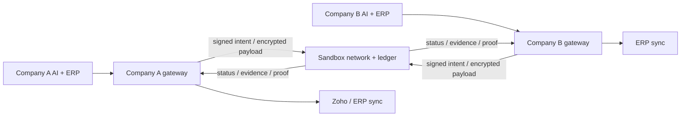

# POC
Proof of Concept for a decentralized interoperable trade data exchange network for Indian domestic B2B traders.

## Status

**Current status:** working prototype v0.2. The repository includes a validated protocol layer, a hosted in-memory sandbox, a Zoho-first ERP adapter, a sovereign-company AI gateway pattern, and typed ONDC/BTN/Sahamati adapter scaffolds.

This project is no longer only a blueprint. It now demonstrates the core building blocks needed for a real sandbox integration path:

- canonical document model
- end-to-end encrypted document exchange
- bilateral append-only ledger prototype
- HTTP-hosted sandbox network for online integration
- ERP adapter for Zoho Books invoice sync
- company-owned AI gateway with signed intent validation and policy enforcement
- preliminary FIP-oriented Account Aggregator (AA) data mapping and encryption utilities

## Architecture

The network is decentralized infrastructure for B2B trade-document exchange and triple-entry accounting. Counterparties sign a shared accounting event, verify the same event, and derive their respective books from it. The ledger remains append-only: corrections, reversals, and disputes are new events, never edits to accepted history.

The exchange and ledger are one logical network with distinct privacy boundaries:

- **Ledger plane:** signed events, commitments, proofs, and derived status provide shared tamper-evident accounting history.
- **Data plane:** end-to-end encrypted documents are transmitted between authorized counterparties. Relays and storage nodes do not receive decryption keys by default.
- **Verification plane:** businesses and partner systems grant scoped permissions to third parties, ERP systems, and AI gateways without unrestricted access to all data.
- **AI gateway plane:** each company runs its own agent gateway, which converts local AI actions into signed, policy-scoped intents before they interact with the shared network.

## Implemented prototype components

### 1. Canonical trade document protocol

The core model defines a canonical invoice and trade-document schema with strict validation for:

- document identity and revisioning
- participant identity enforcement
- tax total consistency
- fixed currency rules
- canonical serialization for signing and hashing

This is implemented in the core schema and canonicalization modules.

### 2. Private exchange and verification

The system supports:

- participant key generation
- signature verification
- document encryption for the recipient
- ciphertext integrity checks
- controlled decryption and verification by the authorized recipient

This is the foundation for privacy-preserving counterpart communication.

### 3. Bilateral append-only ledger

The legacy ledger proposal path requires both trusted counterparties to sign. A separate native TEA lifecycle now supports a seller-signed submission followed by a counterparty acceptance or dispute. The submitted event is provisional; only the counterparty can transition it to confirmed. Events are hash chained and append-only. This remains an in-memory prototype, not a distributed consensus service.

Semantic invoice and credit-note transactions derive balanced posting sets for each participant, including tax component postings. The full transaction is represented by a salted commitment in the shared event; the recipient-encrypted trade package carries the source document and salt, allowing the recipient to independently derive the same transaction and verify the commitment before signing acceptance. The salt is not included in the shared event. The network verifies signatures and lifecycle transitions, not the economic truth of the source data or accounting interpretation.

Amounts in this pilot are denominated in INR paise; the protocol does not issue a currency or settle payments. Zoho major-unit decimals are converted exactly to paise, and invoices with unsupported currencies or tax totals that cannot be reconciled to named GST components are rejected.

The current TEA protocol prototype adds deterministic event IDs, one submission per seller/document/revision, predecessor-linked revisions, typed disputes, and explicit `EXPIRED` and submitter-only `WITHDRAWN` outcomes. Acceptance requires a signed inclusion proof for both the submission and the acceptance event, with checkpoint timestamps preceding submission expiry; the accepting party's signature binds a supported derivation-rule version and the re-derived commitment. `src/core/transparency.ts` provides Merkle inclusion proofs and signed checkpoints, and the sandbox verifies a configured witness quorum. Commitment salts are delivered only inside the recipient-encrypted document package, not in shared event records. Expiry is event-driven: a counterparty must append a witnessed `EXPIRED` event; this sandbox has no expiry worker, so silence alone does not append a terminal event and the reported status remains provisional until one is recorded. This is proof-mechanics testing only: the demo creates its witness keys in-process, the ledger remains in-memory and globally hash-chained, and there is no independent witness service, checkpoint consistency proof, gossip, durable log, or production freshness/availability policy. A witnessed inclusion proof alone does not prevent split views or establish global finality.

The event log is a commercial/accounting workflow record, not a substitute for IRP registration, IRN/acknowledgement, e-way bills, GSTR-2B, or other statutory records. The proposed IRP-first sequence, reconciliation rules, legal effect of provisional/accepted states, encrypted payload/salt retention, and key-loss handling remain subject to tax/legal counsel and pilot-operator decisions.

### 4. Hosted sandbox network

A single-process, in-memory HTTP sandbox is available for controlled integration testing. It binds to `127.0.0.1:3000` by default and exposes endpoints for:

- public-key-only participant registration and lookup
- submission of participant-encrypted, signed envelopes
- legacy bilateral ledger proposal submission and lookup
- TEA lifecycle event submission and lookup (`/tea/events`, `/tea/transactions/{id}`)
- a minimal health check

The server does not receive plaintext documents through the envelope endpoint. Participant gateways must encrypt and sign the envelope before submission. Request bodies are limited to 1 MiB by default, and responses are marked non-cacheable. When an API token is configured, every route except health requires its bearer token. Binding outside loopback requires both a bearer token of at least 32 bytes and TLS certificate/key files. Browser origins are not allowed by default. This sandbox is not production-ready: its state is lost on restart, and production identity governance, durable storage, rate limiting, and monitoring remain outstanding.

### 5. Zoho-first ERP integration

The Zoho Books-oriented adapter now:

- fetches and maps an invoice to the canonical document and balanced semantic posting sets
- creates and submits the encrypted envelope using the seller's locally supplied key material
- submits a seller-signed provisional TEA event and updates ERP metadata to `pending_counterparty`
- allows a buyer gateway to verify the salted commitment and append a signed acceptance or dispute

The end-to-end flow is tested with a fake Zoho HTTP service. Live Zoho OAuth/API compatibility and updating the seller ERP after a later counterparty decision remain future work.

An interactive, browser-only [Zoho acceptance/dispute workflow mock](docs/zoho-tea-review-mock.html) demonstrates the seller and buyer views. Its controls are simulated and do not call Zoho or the network.

### 6. Sovereign AI agent gateways

The project now includes a company-owned AI gateway model that is designed for multi-company participation. Each gateway:

- is associated with a company and participant identity
- signs outbound intents with the participant key
- verifies inbound signed requests
- authorizes only actions allowed by local policy
- restricts documents, recipients, and scopes to permitted values

This is the recommended pattern for cross-company AI communication when each company owns its own infrastructure and data boundary.

### 7. Multi-network adapter scaffolding

`src/adapters/` now contains typed ONDC, BharatTradeNet, and Sahamati adapter boundaries. The ONDC `POST /ondc/confirm` and `POST /ondc/update` routes return a Beckn ACK after validating and mapping the request, then schedule the supplied processor asynchronously. Confirmations map to a dedicated OTN purchase-order model; updates map either to a purchase-order update or to the existing validated OTN invoice model. The receiver is optional and must be supplied when constructing `HostedTradeNetwork`.

The BharatTradeNet utilities canonicalize MLETR-shaped JSON with RFC 8785 and calculate SHA-256 digests. Class-3 DSC signing is represented by an injected signer interface: a real certificate-backed signer must be provided by an approved HSM/DSC integration. The Sahamati scaffold decodes a flexible consent payload, delegates signature verification and disclosure-scope authorization to injected interfaces, maps OTN invoice metadata into a small typed ReBIT-oriented model, and encrypts a package using ephemeral X25519 ECDH with AES-256-GCM.

#### Account Aggregator / Sahamati FIP status

The codebase has a **preliminary FIP-oriented AA scaffold**, not an implemented/live AA integration. It can decode a typed consent artifact, call injected consent-signature and data-authorization interfaces, map an OTN invoice into a small local ReBIT-oriented invoice shape, and produce an encrypted package using ephemeral X25519 ECDH, HKDF-SHA-256, and AES-256-GCM. These functions are in `src/adapters/sahamati/`; they are library functions and are not exposed as AA HTTP endpoints.

There is no connection to the Sahamati registry or its public-key endpoints, no concrete consent signature verifier, no official current ReBIT schema/profile validation, no AA/FIP network transport or callback lifecycle, and no production consent-expiry/revocation or audit implementation. The verifier and authorizer must be supplied by an integration; the current simplified local types and envelope must not be represented as Sahamati-certified or used to disclose real financial information without validating the applicable specifications and implementing the trust, consent, and operational controls.

These adapter contracts are functional scaffolding, not production-certified network implementations. Beckn profile-specific validation and request authentication, ReBIT schemas and encryption envelopes, Sahamati registry verification and AA transport, BTN/MLETR profile conformance, DSC trust-chain validation, retries, durable queueing, and operational controls must be aligned with selected current network profiles before external deployment. The HTTP server's existing bearer-token protection is not a substitute for ONDC's required request authentication.

### 8. Pine Labs B2B payout foundation

`src/core/payouts.ts` adds typed INR payment terms, versioned reusable templates, bilateral agreement references, payout-intent metadata, release-policy evaluation, and a distinct payout status model. `src/adapters/pinelabs/` defines a provider boundary and normalized outcomes only. It does not call Pine Labs, implement authentication or webhook verification, or claim to match a live API contract.

The model supports manual, automatic, and threshold-based release. For threshold policy, the buyer configures whether installments below the threshold are auto-released or still require approval; installments at or above the threshold require approval. Terms may use fixed minor-unit amounts or percentage allocations and define due days from buyer delivery-note approval. The schemas retain approval event references; they do not yet verify that those events exist or are authorized.

No payout routes, durable persistence, worker/queue, buyer approval UI, reconciliation process, or payment execution are implemented. The current network is in-memory and does not settle funds. Implement exact Pine Labs field mappings, idempotency, status meanings, webhook signature verification, and retry/cancel behavior only after reviewing the official payout API pack and sandbox.

## Developer documentation

See the [OTN Developer and Protocol Contribution Guide](docs/DEVELOPER_GUIDE.md) for the repository map, API and adapter boundaries, AA/ONDC/BTN scaffold status, local setup, protocol lifecycle, security limits, and the process for proposing protocol changes. A formatted [ODT version](docs/OTN-Developer-Guide.odt) is provided for publishing or displaying to developers.

## Recommended communication pattern for AI + ERP + network

The optimum pattern is not to let AI systems directly act as network peers. Instead:

1. Each company runs its own AI gateway inside sovereign infrastructure.
2. The gateway converts AI decisions into signed, policy-scoped intents.
3. The shared network validates scope, identity, and signature.
4. Only approved events are appended to the ledger or exposed to counterparties.
5. ERP systems and downstream processes receive event updates through a webhook, queue, or API callback.

This keeps the AI inside the company trust boundary while still enabling secure interoperability.

## Local development and verification

Install dependencies:

npm install

Run tests:

npm test

Run TypeScript build:

npm run build

Run the sandbox locally (loopback only by default):

npm run sandbox

## One-click MVP demo

A browser demo drives one complete B2B trade transaction end-to-end through the
live sandbox — Kerala Industrial Supplies Pvt Ltd (seller) sends invoice
INV-2026-0001 (₹94,400) to Hyderabad Manufacturing Pvt Ltd (buyer):

npm run demo

Then open http://127.0.0.1:8080 and press **START DEMO**. The demo fetches the
invoice from a mocked Zoho Books endpoint on the seller side, maps it to the
canonical trade document, signs it (Ed25519), encrypts it to the buyer
(X25519 sealed box), submits the envelope over HTTP to the real
`HostedTradeNetwork`, appends a seller-signed provisional TEA event with a
salted accounting commitment, then has the buyer pull, decrypt, verify,
independently re-derive the posting sets, and sign acceptance — moving the
transaction to CONFIRMED on the hash-chained ledger. Signed, policy-scoped AI
gateway intents wrap both sides of the exchange. **RESET DEMO** rebuilds keys,
network state and ledger for another run.

No step is simulated: every hash, signature, ciphertext and ledger event shown
in the UI is produced by the actual protocol code in `src/`. The UI is a small
React/TypeScript app in `ui/` (built with `npm run build:ui`), served by the
demo server in `src/demo/` alongside a server-sent event stream at
`/api/demo/stream`.

For a controlled remote sandbox, configure a long random API token and TLS certificate/key before binding beyond loopback:

HOST=0.0.0.0 NETWORK_API_TOKEN='replace-with-a-random-token-at-least-32-bytes' TLS_CERT_PATH='/path/to/cert.pem' TLS_KEY_PATH='/path/to/key.pem' npm run sandbox

Do not use company private keys with the hosted process. Generate keys and create signed, encrypted envelopes inside participant-controlled gateways. The sandbox is in-memory and must not be treated as a production ledger service.

## Build sequence and status

The current project has already completed the following milestones:

1. **Protocol and threat model:** canonical schema, signatures, privacy boundaries, and validation logic.
2. **Private exchange:** encrypted document flow and recipient verification.
3. **Native TEA lifecycle prototype:** balanced semantic postings, provisional submission, signed counterparty decision, witnessed-inclusion proof mechanics, and terminal lifecycle outcomes in a single-process in-memory log.
4. **Sandbox hosting:** HTTP network layer for local and controlled integration testing (in-memory, not production).
5. **ERP integration:** Zoho-first invoice import and ledger update path.
6. **Sovereign AI integration:** company-owned gateway and signed intent policy model.

## Open architecture decisions

These remain important for the next production-ready phase:

- validator participation model and finality assumptions
- independent witness operations, checkpoint consistency/gossip, and split-view detection
- independent witness operations, checkpoint consistency/gossip, and split-view detection
- scope of field visibility across counterparties and verifiers
- delegated authority rules for AI and ERP systems
- statutory reconciliation and legal treatment of provisional/accepted events
- retention, backup, legal-hold, and deletion obligations for encrypted payloads and commitment salts
- operational security for cross-company webhook and queue integrations
- production OAuth and identity setup for ERP providers such as Zoho
- official profile selection, trust integration, and transport implementation for ONDC, BTN, and Sahamati AA

## Full blueprint

See the [full architecture blueprint](ARCHITECTURE_BLUEPRINT.md) and [PDF version](ARCHITECTURE_BLUEPRINT.pdf) for the broader design and governance context.
